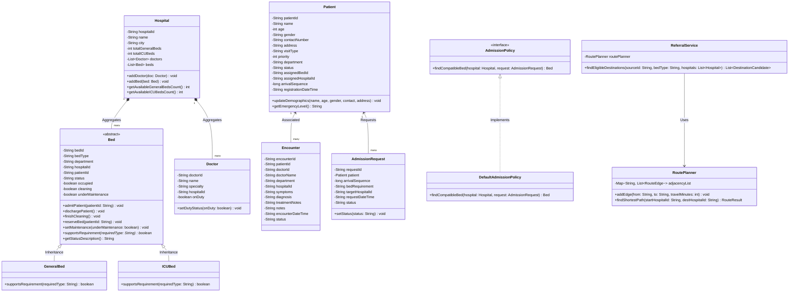

# UML CLASS DIAGRAM & OBJECT-ORIENTED DESIGN — HospitalOOP70

## 1. Class Diagram (Mermaid)

---

## 2. Core OOP Principles Applied

| OOP Principle | Implementation in HospitalOOP70 |
|---|---|
| **Encapsulation** | Strict private fields with guarded getters/setters, parameter validation (e.g. `age >= 1 && age <= 125`), and internal state mutators (`dischargePatient()`, `finishCleaning()`). |
| **Inheritance** | Abstract superclass `Bed` extended by specialized subclasses `GeneralBed` and `ICUBed`, sharing common bed attributes while specializing equipment types. |
| **Polymorphism** | Runtime dispatch through `Bed.supportsRequirement(requiredType)`. Hospitals and data stores handle mixed collections of `Bed` references uniformly without downcasting. |
| **Abstraction** | Abstract contract `Bed` and admission decision interface `AdmissionPolicy` hiding internal traversal and prioritization logic from callers. |
| **Composition & Aggregation** | `Hospital` aggregates collections of `Doctor` and `Bed` entities. `Encounter` and `AdmissionRequest` compose clinical patient records. |
