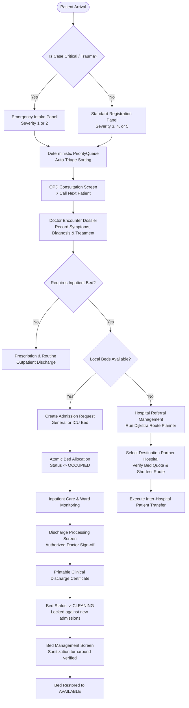

# CLINICAL & OPERATIONAL WORKFLOWS — HospitalOOP70

## 1. Outpatient & Inpatient Clinical Journey

---

## 2. Bed Sanitization & Turnaround Lifecycle
A vital government infection control protocol enforced in HospitalOOP70:

1. **AVAILABLE:** Bed is unoccupied and sanitized. Ready for new admission.
2. **RESERVED:** Bed is temporarily earmarked for an inbound emergency case or incoming transfer.
3. **OCCUPIED:** Patient is admitted. Protected against concurrent double-booking via atomic SQL updates and memory locks.
4. **CLEANING:** When a patient is discharged, the bed **NEVER** transitions immediately to available. It transitions to `CLEANING`. Any attempt to assign a cleaning bed is rejected.
5. **MAINTENANCE:** Engineering inspection lock for broken mechanical or monitoring fixtures.
6. **FINISH CLEANING:** Housekeeping confirms deep sanitation, linen change, and disinfection, restoring the unit to `AVAILABLE`.

---

## 3. Inter-Hospital Referral Algorithm (Dijkstra's Shortest Path)
1. **Source Node:** The origin hospital lacking available ICU or general beds.
2. **Eligibility Filter:** Only target hospitals with `availableCompatibleBeds > 0` are evaluated.
3. **Graph Traversal:** Evaluates weighted edges (fictional highway travel minutes) using a min-heap priority queue.
4. **Optimal Path Selection:** Produces the optimal multi-hop transfer path with the lowest cumulative route weight.
